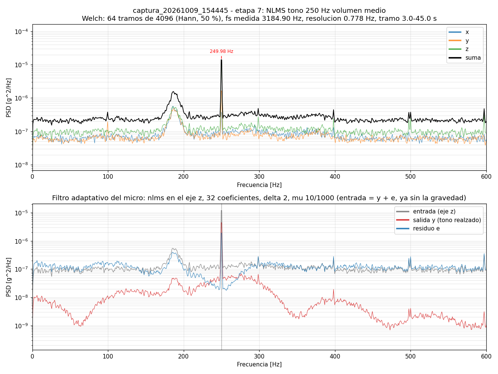
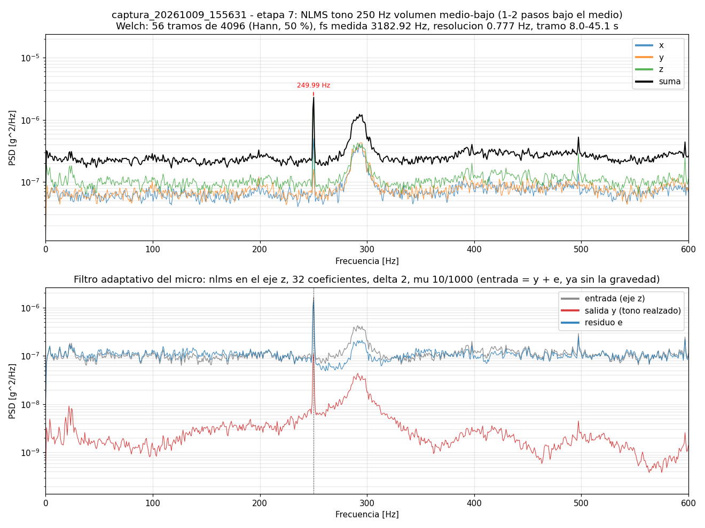
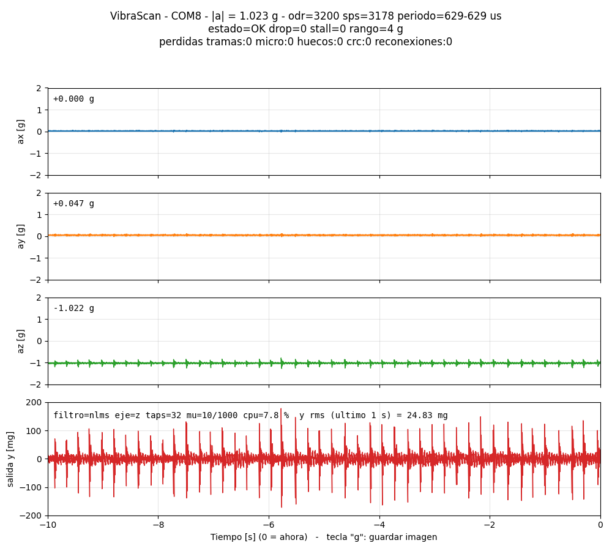
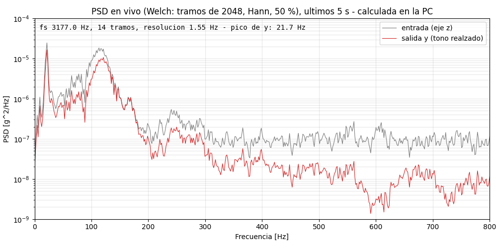
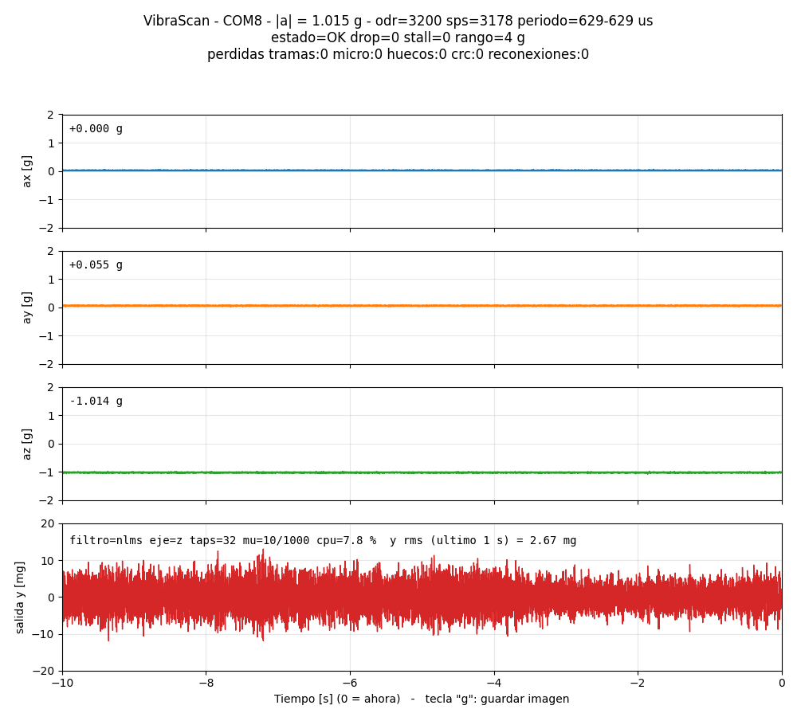
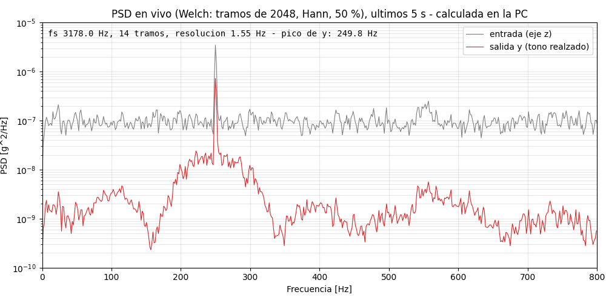

# Filtro adaptativo NLMS en el micro (etapa 7)

Beca de servicio Vibra-Scan 2026 (UTN-FRP). Este documento explica qué filtro
adaptativo corre en la Black Pill (STM32F411), por qué se eligió NLMS, dónde
está cada parte del código y qué resultados dio con señales reales.

El plan de la beca pide "un algoritmo de filtrado adaptativo de baja
complejidad, ejecutado en tiempo real en el sistema embebido", con un
"preprocesamiento básico (normalización, filtrado básico)" y su evaluación
"frente a diferentes condiciones de señal y niveles de ruido". La FFT de
análisis se hace en la PC (Python o MATLAB), no en el micro.

## 1. El problema

Hay **un solo acelerómetro** (ADXL345, 3200 muestras/s, ±4 g). La vibración
que interesa (por ejemplo, la de una máquina o, en las pruebas, un tono
de 250 Hz del parlante de un celular) llega mezclada con:

- el ruido propio del sensor, de banda ancha: unos 250–300 µg/√Hz, que en
  toda la banda (0–1589 Hz) son **~12 mg rms**;
- la gravedad (1 g constante en el eje vertical);
- golpes y vibraciones del entorno.

Un tono de 4 mg rms queda así **por debajo** del ruido total (relación
señal/ruido de −9 dB en toda la banda). En la PSD se ve como un pico angosto
que sobresale ~20 dB del piso, pero en la señal en el tiempo no se distingue.

No hay una segunda señal "de referencia" que tenga solo el ruido (como un
segundo sensor alejado de la fuente). El micrófono lo aporta otro integrante
de la beca, para contrastar resultados al final, pero no se usa como
referencia del filtro.

## 2. Por qué un filtro adaptativo y no uno fijo

Un filtro fijo (por ejemplo un pasabanda alrededor de 250 Hz) funciona solo
si se conoce de antemano la frecuencia de la vibración. En una máquina real:

- la frecuencia no se conoce exactamente, y cambia con la velocidad, la carga
  o la temperatura;
- puede haber varias componentes a la vez;
- el sensor mismo tiene un reloj que se aparta hasta ~0,7 % del nominal
  (medido en la etapa 5), así que hasta las frecuencias "conocidas" se corren.

Un filtro adaptativo **encuentra solo** la componente periódica y la sigue si
se corre, sin configurar ninguna frecuencia.

### Configuración: realzador de líneas (ALE)

Con un solo sensor, el esquema estándar es el **realzador de líneas**
(Adaptive Line Enhancer, Widrow 1975). El filtro intenta predecir la muestra
actual a partir de muestras **retrasadas Δ**:

```
u[n] = [ x[n−Δ], x[n−Δ−1], …, x[n−Δ−M+1] ]     (M coeficientes)
y[n] = w · u[n]                                 predicción: parte periódica
e[n] = x[n] − y[n]                              error: parte de banda ancha
w   ← w + μ · e[n] · u[n] / (ε + u[n]·u[n])     adaptación NLMS
```

La idea: una componente periódica se puede predecir desde varias muestras
atrás; el ruido blanco no (con Δ ≥ 1 ya está descorrelacionado). Al minimizar
el error, el filtro aprende a reproducir solo lo predecible:

- **y** = la vibración periódica realzada (el filtro se comporta como un
  pasabanda de ~fs/M de ancho centrado en el tono, que se ubica solo);
- **e** = el residuo: ruido de banda ancha y transitorios.

## 3. Por qué NLMS

| Algoritmo | Costo por muestra (M = 32) | Por qué sí / por qué no |
|---|---|---|
| **LMS** | 2M ≈ 64 multiplicaciones | El paso μ que lo hace estable depende de la **potencia de la señal** (0 < μ < 2 / (M σ²)). Un golpe o un cambio de rango puede hacerlo divergir. |
| **NLMS** (elegido) | 3M ≈ 96 multiplicaciones + 1 división | Igual que LMS, pero el paso se divide por la energía de la entrada (u·u): es estable para **0 < μ < 2 sin importar el nivel**. Baja complejidad y comportamiento predecible. |
| RLS | ~3M² ≈ 3000 multiplicaciones | Converge más rápido, pero cuesta ~30 veces más y en float32 es numéricamente delicado (la matriz P pierde simetría). Para un tono estacionario la velocidad extra no hace falta. |
| Kalman | depende del modelo | Necesita un modelo de estados de la vibración (frecuencias, amortiguamiento): justamente lo que no se conoce. |
| Notch / pasabanda fijo | bajo | Requiere conocer la frecuencia (ver sección 2). |
| Notch adaptativo | bajo | Buena opción para **un solo** tono; queda como alternativa futura (ver sección 8). |

**Prueba de la ventaja de NLMS sobre LMS** (`test_vibrascan_filtro.py`,
`test_nlms_no_depende_del_nivel_y_lms_si`): con el mismo μ, NLMS da la misma
salida (escalada) para una señal 100 veces más grande (diferencia 0,5 % rms),
mientras que LMS, con un paso que funciona bien para la señal original,
**diverge** con la señal 100 veces más grande. En el sensor eso es un golpe
(de 10 mg de vibración a más de 1 g) o un cambio de rango.

## 4. Parámetros

| Parámetro | Valor | Por qué |
|---|---|---|
| Preprocesamiento | pasaaltos RC de 1er orden, 1 Hz | Saca la gravedad y la deriva lenta (la "normalización básica" del plan). La primera muestra inicializa el estado, así la gravedad no entra como un escalón de 1 g. |
| M (coeficientes) | 32 | Ancho de la banda que pasa ≈ fs/M ≈ 100 Hz. Más coeficientes mejoran la SNR con ruido moderado, pero cuestan CPU (lineal) y agregan ruido de adaptación con señales muy débiles (barrido en la sección 7.4). |
| Δ (retardo) | 2 muestras (0,6 ms) | Para ruido blanco alcanza con Δ = 1; 2 deja margen por si el ruido del sensor tiene algo de correlación entre muestras vecinas. Ver la sección 7.5: con golpes, un Δ mayor podría convenir. |
| μ (paso) | 0,010 | Compromiso entre velocidad (convergencia medida: 0,2–0,25 s) y ruido de adaptación (desajuste ≈ μ/2 = 0,5 %). |
| ε | 1·10⁻⁶ g² | Solo evita dividir por cero al arrancar (u·u típico ≈ 5·10⁻³ g²). |
| Aritmética | float32 (FPU del Cortex-M4) | El M4F tiene FPU de simple precisión; la diferencia con doble precisión es menor a 3 µg (sección 7.1). |

Todos menos ε y el pasaaltos se cambian sin recompilar, con comandos por el
puerto: `filtro=nlms|off`, `eje=x|y|z`, `taps=1..64`, `delta=1..32`,
`mu=1..1999` (milésimas). Cada cambio reinicia el filtro y se informa en la
trama de estado (y queda en el JSON de cada captura). Hoy no hay un script de
la PC que mande estos comandos (`captura.py` solo manda `odr=` y `rango=`).

### Eje: Z

Se filtra un eje por vez, el **Z** (perpendicular a la mesa), elegible con
`eje=`. En las pruebas con el celular apoyado en la mesa, el tono de 250 Hz
midió **4,4 mg rms en Z, 1,6 mg en Y y no se detectó en X**
(captura del 2026-10-09, volumen medio). Las vibraciones que transmite una
superficie llegan sobre todo en la dirección normal a ella. Filtrar los tres
ejes costaría ~3 veces el CPU (≈ 24 %), posible pero fuera del alcance de esta
etapa.

## 5. Dónde se ejecuta cada parte

### En el micro (C, tiempo real)

| Qué | Archivo y función |
|---|---|
| Algoritmo NLMS (una muestra) | `nlms_procesar()` en [Core/Src/nlms.c](../Core/Src/nlms.c) |
| Cadena del eje: pasaaltos + algoritmo elegido | `filtro_procesar()` en [Core/Src/filtro.c](../Core/Src/filtro.c) |
| Llamada por cada muestra del eje elegido, reinicio ante huecos, medición del CPU | `filtrar_bloque()` en [Core/Src/app.c](../Core/Src/app.c) |
| Envío de la salida a la PC (trama tipo 4 por bloque de 32 muestras) | `send_samples()` en [Core/Src/app.c](../Core/Src/app.c), línea con el comentario `/* etapa 7: filtro adaptativo en tiempo real */` |
| Comandos `filtro=`, `eje=`, `taps=`, `delta=`, `mu=` | `cmd_filtro()` en [Core/Src/app.c](../Core/Src/app.c) |

La cadena de llamadas es:

```
app_loop()  →  send_samples()  →  filtrar_bloque()  →  filtro_procesar()  →  nlms_procesar()
 (app.c)        (app.c)            (app.c)              (filtro.c)            (nlms.c)
```

El filtro corre en el **lazo principal**, no en la interrupción del sensor.
La lectura del FIFO del ADXL345 (interrupción + DMA, etapa 6) tiene prioridad
y no se demora: si la lectura pisa la conversión siguiente del sensor, el eje
Z sale desviado. `nlms.c` y `filtro.c` no conocen HAL, USB ni el sensor: se
compilan igual en la PC para las pruebas.

### En la PC (Python)

| Qué | Archivo |
|---|---|
| Referencia en doble precisión, misma estructura y nombres que el C (`Nlms`, `Pasaaltos`, `Filtro`, `nlms()`) y teoría (`ganancia_ale()`, `snr_banda_db()`) | [pc/vibrascan_filtro.py](../pc/vibrascan_filtro.py) |
| Pruebas sin placa: señales sintéticas y el C compilado con gcc contra Python | [pc/test_vibrascan_filtro.py](../pc/test_vibrascan_filtro.py), [test_fw/filtro_pc.c](../test_fw/filtro_pc.c) |
| Prueba de aceptación con la placa (`equivalencia` y `tono`) | [pc/etapa7_prueba.py](../pc/etapa7_prueba.py) |
| Recepción y guardado de la salida (`<base>_filtro.csv`: n, y, e, reinicio) | [pc/vibrascan_captura.py](../pc/vibrascan_captura.py), [pc/vibrascan_proto.py](../pc/vibrascan_proto.py) |
| PSD de entrada, y y e de una captura (`--filtro --tono F`) | [pc/espectro.py](../pc/espectro.py) |
| Visor en vivo: panel de y en mg y ventana de PSD en vivo (`--psd`) | [pc/monitor_vivo.py](../pc/monitor_vivo.py) |

La FFT/PSD se calcula **en la PC** (Welch: ventana de Hann periódica, tramos
con 50 % de solapamiento, media restada por tramo, escala de densidad en
g²/Hz).

### En MATLAB

[matlab/cargar_captura.m](../matlab/cargar_captura.m) lee una captura (CSV +
JSON, compatible con R2015b) incluida la salida del filtro (`cap.filtro.y`,
`cap.filtro.e`), y [matlab/ejemplo_fft.m](../matlab/ejemplo_fft.m) hace la FFT
de un eje. **Todavía no se probaron en MATLAB.**

```matlab
cap = cargar_captura('..\pc\capturas\captura_20261009_154445');
plot(cap.filtro.y)        % salida realzada del filtro del micro, en g
```

## 6. Cómo agregar otro filtro

`filtro.c` es el único lugar que elige el algoritmo:

1. Escribir el algoritmo en su propio archivo, sin HAL (como `nlms.c`), con
   una función que procese **una muestra** y devuelva y y e.
2. Agregar un valor en `filtro_tipo_t` (`filtro.h`) y su estado en `filtro_t`.
3. Agregar un `case` en `filtro_procesar()` y su configuración en
   `filtro_configurar()`.
4. Agregar el comando (por ejemplo `filtro=rls`) en `cmd_filtro()` de `app.c`.
5. Escribir su referencia en `pc/vibrascan_filtro.py` y agregarla a
   `test_vibrascan_filtro.py` y a `test_fw/filtro_pc.c`, para comparar C y
   Python igual que con NLMS.

La trama tipo 4 ya lleva el tipo de filtro, así que la PC no necesita cambios
para recibirlo.

## 7. Resultados

### 7.1 El micro calcula lo mismo que Python

Se repite en Python (doble precisión) el filtrado del micro (float32) sobre
las mismas muestras crudas, reiniciando en los mismos puntos:

| Prueba | Diferencia máxima |
|---|---|
| Captura real a 3200 Hz, 45 s (143 424 muestras), salida y | 0,6–1,1 µg |
| Ídem, residuo e | 1,5–2,7 µg |
| C compilado en la PC contra Python, 3 señales sintéticas | < 0,1 µg |

El límite de aceptación es 100 µg (39 veces menos que una cuenta del sensor,
3,9 mg). La diferencia es solo el redondeo de float32.

### 7.2 Tiempo real

| Medición | Valor |
|---|---|
| CPU del filtro a 3200 Hz, M = 32 (optimizado -O2) | **7,8 %** |
| Ídem sin optimizar (-O0, como el resto del proyecto en Debug) | 18 % |
| Memoria del filtro | ~650 bytes (coeficientes e historia) + 264 bytes de trama |
| Pérdidas de muestras con el filtro activo (sesiones de hasta 10 min) | 0 |

El CPU se mide con el contador de ciclos (DWT) alrededor de cada bloque, y
es una **cota superior**: incluye el tiempo de las interrupciones que caen en
el medio. Solo `nlms.c` y `filtro.c` se compilan con `-O2`
(`#pragma GCC optimize`); el resto sigue en `-O0` para depurar, y así la
temporización de la lectura del FIFO no cambió.

### 7.3 Distintos niveles de ruido: tono de 250 Hz

Tono de 250 Hz del parlante de un celular apoyado en la mesa, a distintos
volúmenes. Medida: SNR **en toda la banda** (potencia del tono contra la de
todo lo demás). Es la medida que mejora un ALE, que deja pasar una banda
angosta y saca el ruido del resto; una medida local (pico sobre el piso
cercano) no la ve. La ganancia del tono se compara con la solución de Wiener
del ALE: G = (M r/2) / (1 + M r/2), con r la SNR lineal de la entrada.

| Volumen | Tono (rms) | SNR entrada | SNR en y | Mejora | Ganancia del tono: medida / teoría |
|---|---|---|---|---|---|
| Alto | — | +2,4 dB | +11,1 dB | **+8,6 dB** | −0,1 / −0,3 dB |
| Medio | 4,4 mg | −9,0 dB | −0,8 dB | **+8,3 dB** | −4,3 / −3,5 dB |
| Medio (otra sesión, 2026-10-16) | 3,4 mg | −11,1 dB | −0,3 dB | **+10,9 dB** | — |
| Medio-bajo | 1,4 mg | −18,7 dB | −13,0 dB | **+5,6 dB** | −11,4 / −15,0 dB |
| 30–35 % | — | — | — | no medible | el tono queda al nivel del piso de ruido |

- Convergencia: y llega al 90 % de su amplitud final **0,20 s** después de
  prenderse el tono (volumen alto).
- Hasta SNR ≈ −10 dB el filtro mejora más de 8 dB y la ganancia coincide con
  la teoría dentro de 1 dB.
- Por debajo de ≈ −15 dB está el **límite**: la mejora baja de 6 dB y la
  teoría de Wiener deja de predecir bien, porque con μ fijo los coeficientes
  no se quedan quietos en el óptimo (siguen moviéndose con el ruido).



*Captura a volumen medio (`espectro.py --filtro --tono 250 --desde 3`). Abajo:
la entrada (gris) tiene el piso de ruido plano; y (rojo) conserva el pico de
250 Hz y queda 10–100 veces por debajo de la entrada lejos de él; e (azul)
tiene un pozo en 250 Hz, porque el tono se fue a y. El ancho de la "campana"
de y, ±100 Hz, es el fs/M del ALE. La componente cercana a 190 Hz es una
vibración del ambiente que cae dentro de esa campana.*



*Volumen medio-bajo: el caso del límite.*

### 7.4 Cantidad de coeficientes (M)

Mismos datos crudos, filtrados en Python con distintos M:

| M | Mejora, volumen medio | Ganancia medida / teoría | Mejora, volumen medio-bajo |
|---|---|---|---|
| 16 | +6,2 dB | −6,1 / −6,1 dB | +5,2 dB |
| **32** | **+8,2 dB** | −4,4 / −3,6 dB | **+5,6 dB** |
| 64 | +10,8 dB | −2,0 / −2,0 dB | +3,1 dB |

Con ruido moderado, más coeficientes = banda más angosta = más mejora. Con
señal muy débil, M = 64 es el peor, porque cada coeficiente que se mueve con
el ruido suma ruido a y. **M = 32** es el mejor compromiso de los medidos, y
cuesta la mitad de CPU que 64.

### 7.5 Golpes: una limitación del ALE

Prueba con golpecitos sobre la mesa (~4 por segundo, ~200 mg de pico en Z):





| Banda | Potencia de la entrada que pasa a y |
|---|---|
| 0–50 Hz | 72 % |
| 50–200 Hz | 59 % |
| 200–500 Hz | 37 % |
| 500–1589 Hz | 9 % |
| Golpe completo (primeros 15 ms) | 56 % de la energía |

Cada golpe hace "sonar" la mesa en ~115 Hz (y hay un pico en ~22 Hz). Esa
oscilación cambia poco en Δ = 0,6 ms: para el filtro es predecible, como un
tono, y pasa a y. Solo el frente del impacto y el contenido de alta
frecuencia van a e.

**El ALE separa lo predecible de lo impredecible, no "el tono" de "los
golpes"**: realza cualquier componente de banda angosta, incluida la
resonancia que deja un golpe.

Con la referencia de Python sobre los mismos datos, se probó un Δ mayor:

| Δ | Energía de los golpes en y | Mejora del tono de 250 Hz |
|---|---|---|
| 2 (0,6 ms, actual) | 56 % | +10,9 dB |
| 8 (2,5 ms) | 28 % | +11,0 dB |
| 16 (5,0 ms) | 44 % | +11,0 dB |
| 32 (10,1 ms) | 31 % | +11,0 dB |

Δ = 8 deja pasar la mitad del golpe sin perder nada en el tono. La relación no
es monótona (Δ = 16 empeora), porque depende de la fase de la oscilación de
115 Hz (período 8,7 ms) a la distancia Δ. Es una sola sesión con un solo tipo
de golpe: se deja Δ = 2 y queda como trabajo futuro (sección 8).

### 7.6 Monitor en vivo

`monitor_vivo.py` muestra la salida y en mg y, con `--psd`, la PSD en vivo de
la entrada y de y (últimos 5 s, 2 veces por segundo, calculada en la PC):





Con el tono, el rms de y pasa de ~1,2 mg (silencio) a 2–3,7 mg, y la PSD en
vivo muestra el pico en 249,8 Hz con y por debajo de la entrada en el resto
de la banda.

## 8. Limitaciones y trabajo futuro

- **Límite de SNR:** con M = 32 y μ = 0,010, por debajo de ≈ −15 dB (en toda
  la banda) la mejora es menor a 6 dB. Para señales tan débiles habría que
  bajar μ (a costa de converger más lento) o promediar más (la PSD de la PC ya
  lo hace).
- **Transitorios:** las resonancias que dejan los golpes pasan a y (sección
  7.5). Opciones: evaluar Δ ≈ 8 con más tipos de golpe, o congelar la
  adaptación mientras dura un golpe (detectándolo por |e|).
- **y en silencio no es cero:** pasa ~1–2 mg rms de ruido (la banda de ±100 Hz
  más el movimiento de los coeficientes).
- **Un eje por vez.** Tres ejes costarían ~24 % de CPU.
- **Otros algoritmos:** un notch adaptativo (más barato, para un solo tono) o
  RLS (más rápido, más caro) se agregan siguiendo la sección 6.
- **MATLAB:** los archivos de `matlab/` no se probaron todavía.
- **Comparación con el micrófono:** pendiente, con las mediciones del otro
  integrante de la beca.

## 9. Cómo reproducir los resultados

Desde `pc/`, con la Black Pill por USB (COM8 en la PC de escritorio):

```bash
# Sin placa: teoría, C contra Python y LMS contra NLMS
python -m unittest test_vibrascan_filtro -v

# Captura con el filtro activo (5 s de silencio y después el tono)
python captura.py --port COM8 --segundos 45 --odr 3200 --rango 4 --nota "tono 250 Hz volumen medio"

# Micro contra Python, y CPU
python etapa7_prueba.py equivalencia capturas/captura_<fecha>

# Mejora de SNR, ganancia contra la teoría y convergencia
python etapa7_prueba.py tono capturas/captura_<fecha> --frecuencia 250
python etapa7_prueba.py tono capturas/captura_<fecha> --frecuencia 250 --inicio 5   # tono débil

# PSD de la entrada, y y e
python espectro.py capturas/captura_<fecha> --filtro --tono 250 --desde 8

# En vivo, con la ventana de PSD
python monitor_vivo.py --port COM8 --odr 3200 --psd --fmax 800
```

Las capturas usadas en este documento están en `pc/capturas/` (fuera de git):
`captura_20261009_154222` (alto), `captura_20261009_154445` (medio),
`captura_20261009_155631` (medio-bajo, `--inicio 5`),
`monitor_20261016_132513` (tono en vivo) y `monitor_20261016_133019`
(golpes, 514–548 s).
