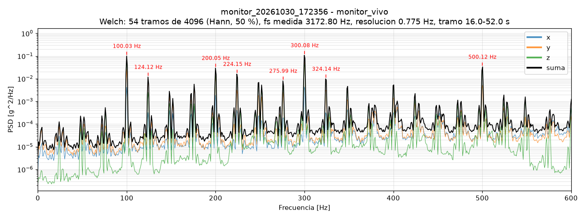
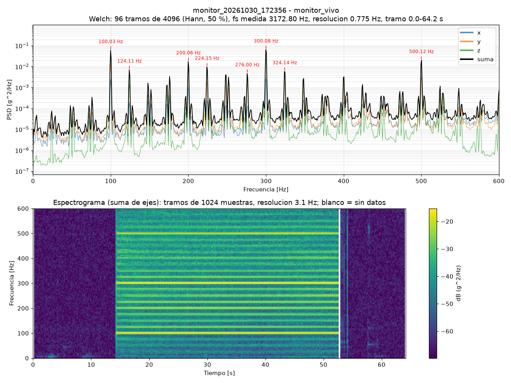
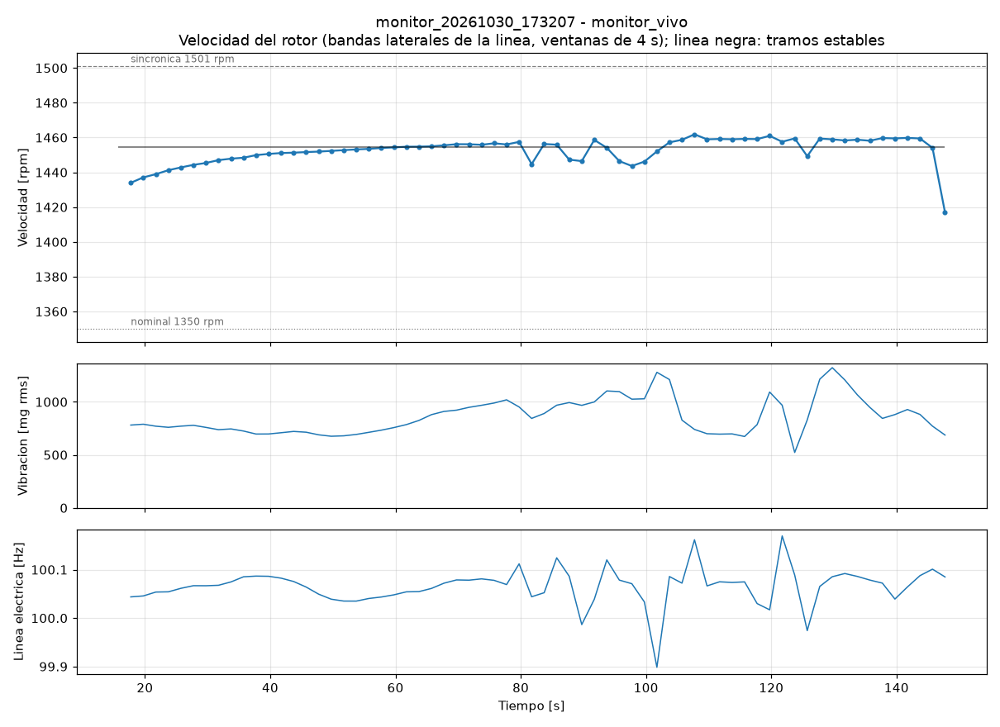
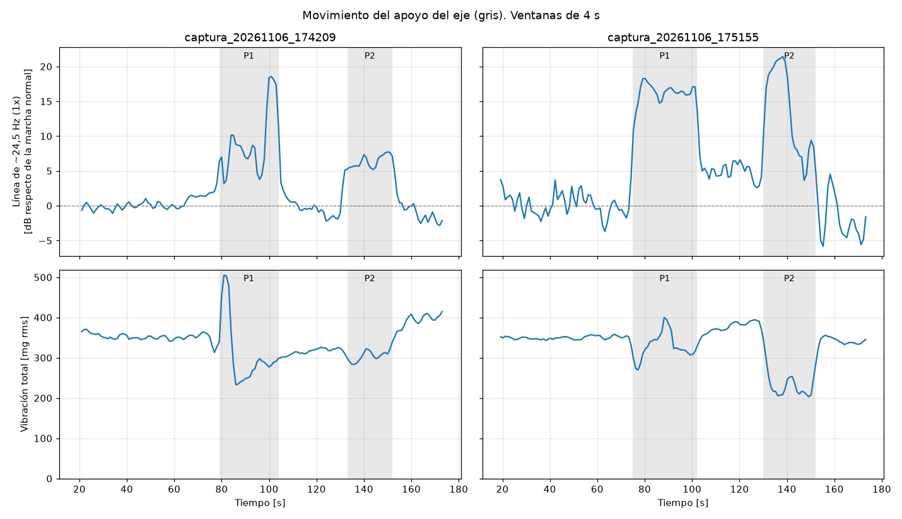
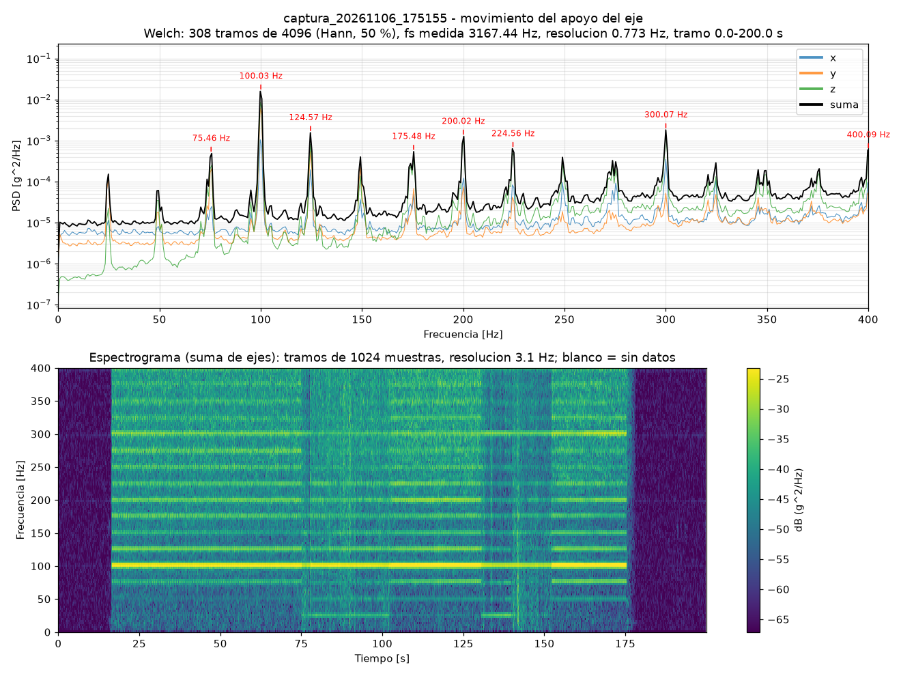
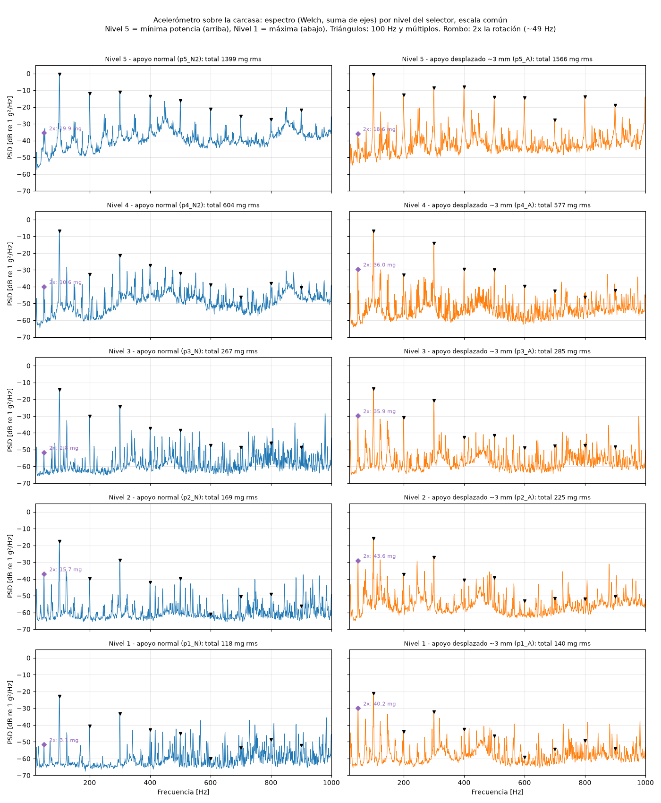
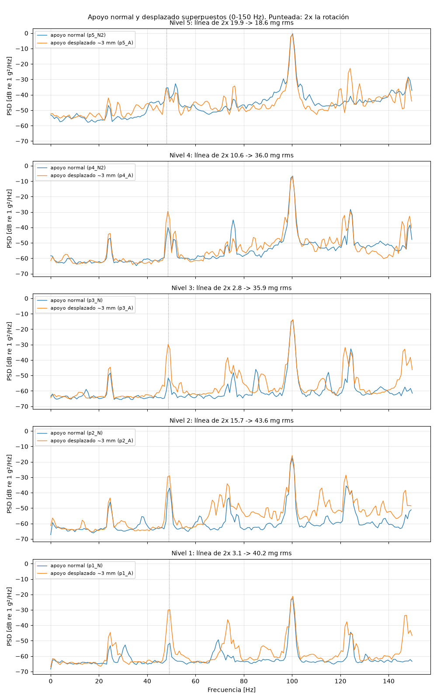
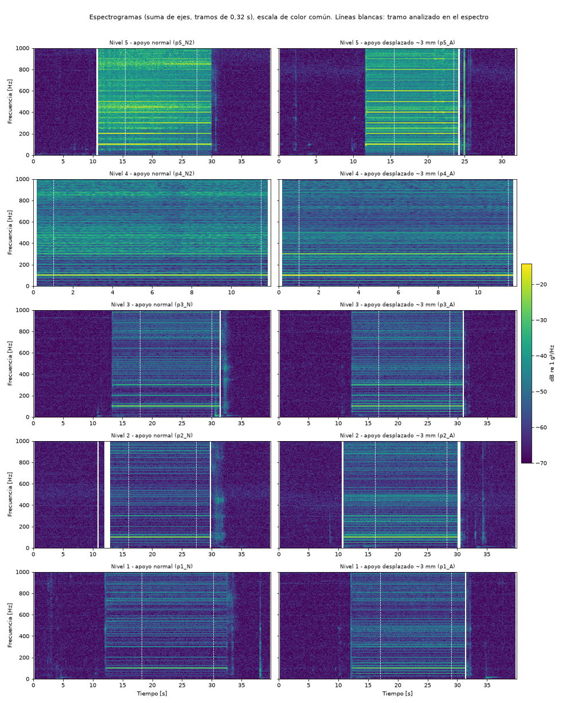
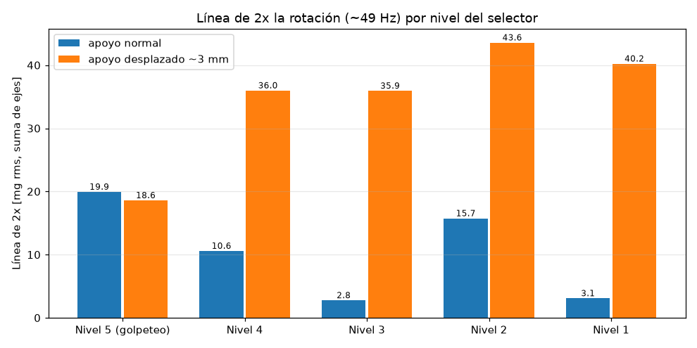

# Prueba con un motor (etapa 7)

Beca de servicio Vibra-Scan 2026 (UTN-FRP). Este documento explica qué se ve en
la FFT con el sensor pegado a la carcasa de un motor, cómo se mide su velocidad
a partir de la vibración, qué resultados dio y cómo repetir la prueba.

Resultado: la FFT muestra la vibración del motor de forma clara y repetible, y
de ella sale la velocidad del rotor: **~1435–1460 rpm** en las cuatro sesiones.
Esa velocidad es coherente con un motor de 4 polos, pero **todavía no se comparó
con una medición independiente** (tacómetro o cámara lenta).

## 1. Montaje

- ADXL345 a 3200 muestras/s y ±16 g, pegado plano sobre la carcasa (Z radial).
- Motor sin chapa de datos. La hoja de datos de un **modelo similar** indica
  1350 rpm a plena carga.
- Las capturas se hicieron con `monitor_vivo.py --psd`, que graba mientras
  grafica. Están en `pc/capturas/` (fuera de git): `monitor_20261030_164410`,
  `_170557`, `_172356` y `_173207`.

El montaje importa. En la segunda sesión el sensor cambió de inclinación hasta
~35°; en la tercera, ya firme, el piso de ruido de Z con el motor andando bajó
de 4,2 a 1,1 mg/√Hz y la vibración total, de 1,6 a 0,8 g rms.

## 2. Qué se ve en la FFT



*Sesión `_172356`, de 16 a 52 s. Con el motor apagado no aparece ninguna de estas
líneas.*

| Componente | Frecuencia (`_172356`) | Qué es |
|---|---|---|
| Línea eléctrica | **100,03 Hz** (47 dB sobre el piso en Z) | 2 × la frecuencia de la red: la fuerza magnética tiene dos máximos por ciclo |
| Sus armónicas | 200, 300, 400, 500 Hz… | |
| Bandas laterales | 100 ± 24,1 Hz, 100 + 48,1 Hz, 300 ± 24,1 Hz… | La rotación modula la línea: su separación es la velocidad del rotor |
| 2× y 3× directos | 48,2 y 72,2 Hz, débiles (12–17 mg) | Armónicas de la rotación |

La línea es eléctrica porque sigue a la red: da entre 99,95 y 100,07 Hz según la
sesión. Con el motor andando vale unos cientos de mg rms; la línea es 50–56 dB
más fuerte que con el motor apagado.



*Las líneas aparecen y desaparecen con el motor, en menos de 0,3 s. Al apagar no
se ve el rotor frenando: ninguna línea baja de frecuencia, así que el frenado no
sirve para identificar la rotación. El motivo no se investigó (podría ser mucha
carga o poca inercia).*

## 3. Cómo se mide la velocidad

El pico directo de la rotación (1×) es muy débil, así que se usan las bandas
laterales. `pc/vibrascan_motor.py`, en ventanas de 4 s cada 2 s:

1. **Línea:** el máximo cerca de 2 × red. Con variador de frecuencia (`--variador`)
   la línea se mueve con la velocidad, y se busca la frecuencia cuyas armónicas
   mejor explican el espectro.
2. **Separación:** la que mejor explica el peine `k·f_L ± m·f_1`. También se cuentan
   las bandas a 2·f_1, para que no gane la mitad o el doble de la separación real.
3. **Ajuste fino:** promedio de la posición de cada banda encontrada (hasta 20 por
   ventana). Con menos de 3 bandas la velocidad queda sin valor: no se inventa.

**Límite:** la búsqueda llega hasta la velocidad sincrónica (`f_L / polos`), así que
**necesita saber los polos** (`--rpm-nominal` o `--polos`). Sin ese dato llega hasta
`f_L / 2` y en algunas ventanas de la primera sesión confundió la rotación con la
familia de 50 Hz (dio 3000 rpm). Los 4 polos de este motor salen de la hoja de datos
de un modelo similar: si fueran otros, la velocidad medida podría ser errónea.

Con un motor sintético de velocidad conocida el error es menor a 0,03 Hz (2 rpm),
también con el reloj derivando y con muestras corruptas (`test_vibrascan_motor.py`).
Con datos reales, en un tramo estable (110–116 s de `_173207`) las ventanas
sucesivas coinciden en ±1 rpm. Eso es repetibilidad, no exactitud.

## 4. Resultados

`python etapa7_prueba.py motor <captura> --rpm-nominal 1350` aprueba las cuatro
sesiones:

| Sesión | Motor prendido | Velocidad, mediana (5–95 %) | Línea | Vibración | Bandas por ventana |
|---|---|---|---|---|---|
| `_164410` | 42 s, en 2 tramos | 1441 rpm (1434–1450) | 99,97 Hz | 1,9–2,7 g rms | 20 |
| `_170557` | 55 s | 1450 rpm (1438–1455) | 100,00 Hz | 1,6 g rms | 20 |
| `_172356` | 40 s | 1447 rpm (1435–1452) | 100,03 Hz | 0,8 g rms | 20 |
| `_173207` | 137 s, con carga en el eje | 1455 rpm (1440–1460) | 100,07 Hz | 0,8 g rms | 20 |

El deslizamiento es de 3–4 %. La hoja de datos implica ~10 % a plena carga
(1350 rpm contra 1500), así que las mediciones son coherentes con un motor poco
cargado, que gira más cerca de la velocidad sincrónica.

### Calentamiento y carga (`_173207`)



- **Al arrancar, la velocidad sube sola** de ~1434 a ~1455 rpm en el primer minuto.
  Pasa en todos los arranques de las cuatro sesiones, y empieza siempre en el mismo
  valor, incluso el de `_164410` que vino solo 110 s después de apagar el motor. Por
  eso **no parece ser el calentamiento del motor**, que no se enfriaría en ese tiempo:
  se parece más a algo que se asienta en cada arranque (por ejemplo, la carga que
  mueve el motor). La causa no se conoce.
- **Con carga en el eje** la vibración llega a 1,3 g rms (contra ~0,7 g) y el espectro
  se vuelve irregular. Aparecen caídas de velocidad de 10–15 rpm, por ejemplo de
  88 a 90 s y de 96 a 100 s. **Los instantes de la carga no se registraron**, así
  que no se puede asignar cada cambio a una carga: de 128 a 132 s la vibración es la
  más alta y la velocidad no baja. Una prueba por escalones (sección 6) lo resuelve.
- **Lo que se mueve la línea durante la carga** (99,9–100,17 Hz) no es la red, que no
  cambia tan rápido: es un efecto de medir una señal que cambia dentro de la ventana.

### El filtro adaptativo con el motor

`etapa7_prueba.py equivalencia` aprueba las cuatro sesiones: el micro calcula lo
mismo que Python también con estas señales grandes. La diferencia sube con la señal
(redondeo de float32): 20–23 µg contra los ~1 µg del tono, y **80 µg** en `_172356`,
la sesión con las muestras corruptas, cerca del límite de 100 µg. El CPU sigue en
7,8 %.

No se evaluó cuánto mejora el filtro con el motor: con líneas 30–47 dB sobre el piso
no hace falta realzarlas para verlas en la FFT, y hay muchas líneas juntas en la
banda de ±100 Hz del ALE.

## 5. Dos problemas encontrados

### Lecturas corruptas al prender o apagar

Justo al accionar el motor llegaron valores que el sensor no puede dar: a ±16 g el
rango es de −4096 a 4095.

| Sesión | Instante | Muestras (x, y, z en cuentas) | Otros efectos |
|---|---|---|---|
| `_164410` | al prender, 153,9 s | (4100, 0, 238) | `ovr` y hueco de 1,6 ms |
| `_172356` | al apagar, 52,8 s | (0, 16384, −7680) y (520, 16384, 513) | la hora de un bloque retrocedió 0,6 ms |

En `_172356` el monitor informó un "golpe" de 70,6 g; el pico real fue 4,5 g. El CRC
da bien, así que el dato ya estaba mal al leerlo del sensor. Lo más probable es una
perturbación eléctrica del interruptor sobre los cables, pero **la causa no se midió**.
En `_173207`, sin ningún cambio de por medio, no pasó.

En la PC ahora: la captura informa el evento `CORRUPTA` y lo suma al JSON, el monitor
no la grafica ni la cuenta como golpe, y `cap.g` la interpola para que no entre a
golpes ni espectros. **El CSV y `cap.c` conservan el valor crudo.**

Limitaciones: una lectura corrupta con un valor posible no se detecta, y el filtro del
micro las recibe igual (el firmware no cambió). Para reducirlas se puede probar con
cables más cortos y trenzados, o con el motor en otro tomacorriente.

### El reloj del sensor deriva

En `_173207` la tasa de muestreo bajó de forma continua de 3171,4 a 3165,4 Hz
(−0,19 %) en 4 minutos, y siguió bajando con el motor apagado. Probablemente es el
sensor calentándose con la carcasa, aunque la temperatura no se midió.

`vibrascan_espectro.psd()` usaba una sola tasa por segmento, y a 500 Hz el error llegaba
a ~0,4 Hz. Ahora cada tramo de Welch usa su tasa local, que sale de `t_s` (reloj del
micro). La comprobación es que las armónicas ahora cierran:

| 18–150 s de `_173207` | 100 Hz | 300 Hz / 3 | 500 Hz / 5 |
|---|---|---|---|
| Con una tasa por segmento | 100,06 | 100,03 | 100,02 |
| Con la tasa local | 100,06 | 100,06 | 100,06 |

El espectrograma (resolución de 3,1 Hz) y la PSD en vivo siguen usando una sola tasa.

## 6. Cómo repetir la prueba

Desde `pc/`, con la Black Pill por USB y sin el ST-Link:

```bash
# Sin placa
python -m unittest test_vibrascan_motor -v

# Para ver el espectro en vivo (cerrar antes de capturar: el puerto es uno solo)
python monitor_vivo.py --port COMx --odr 3200 --rango 16 --psd --fmax 800

# Captura: empezar con al menos 5 s de motor apagado
python captura.py --port COMx --segundos 90 --odr 3200 --rango 16 --nota "motor"

# Análisis: chequeos, tabla de velocidades y <captura>_motor.png
python etapa7_prueba.py motor capturas/captura_<fecha> --rpm-nominal 1350
```

### Variando la velocidad por escalones

1. Al menos 5 s con el motor apagado.
2. Cada velocidad, **al menos 20 s estable** (cada una da unas 8 mediciones). Conviene
   empezar con ~1 minuto a velocidad máxima, porque al arrancar la
   velocidad sigue subiendo.
3. Anotar en `--nota` las velocidades y el orden.
4. Apagar y dejar unos 5 s más.

```bash
# Tension variable (dimmer, autotransformador): la linea sigue en 100 Hz
python etapa7_prueba.py motor capturas/captura_<fecha> --rpm-nominal 1350 --escalones 4

# Variador de frecuencia: la linea se mueve con la velocidad
python etapa7_prueba.py motor capturas/captura_<fecha> --rpm-nominal 1350 --escalones 4 --variador
```

Dos velocidades a menos de 20 rpm se cuentan como un solo escalón. Si a una velocidad
baja la vibración cae por debajo de 100 mg rms, ese tramo se toma como motor apagado.

## 7. Movimiento del apoyo del eje (2026-11-06)

Se movió a mano el apoyo del extremo opuesto del eje, dos veces (P1 y P2) en cada una de
dos capturas de 200 s: `captura_20261106_174209` y `captura_20261106_175155` (3200 Hz,
±16 g). Secuencia: apagado, marcha normal, P1, pausa, P2, pausa, apagado. Las dos salieron
con 0 pérdidas, 0 muestras corruptas y 0 saturadas, y `etapa7_prueba.py equivalencia` aprueba
(diferencia máxima con Python: 7,2 µg).



Cambio respecto de la marcha normal (25–75 s y 20–72 s; PSD de la suma de ejes):

| Medida | `174209` P1 (85–94 s) | `174209` P2 (135–149 s) | `175155` P1 (78–100 s) | `175155` P2 (133–151 s) |
|---|---|---|---|---|
| **Línea de ~24,5 Hz (1×)** | **+7,4 dB** | **+5,8 dB** | **+15,9 dB** | **+16,7 dB** |
| Línea de 249,1 Hz | −16,6 dB | −12,9 dB | −9,0 dB | −10,8 dB |
| Banda de 124,5 Hz | −14,1 dB | −10,6 dB | −2,5 dB | −12,8 dB |
| Línea de 224,6 Hz | +7,2 dB | +13,9 dB | −0,6 dB | −6,8 dB |
| Línea de 100 Hz | +1,6 dB | +2,3 dB | −0,4 dB | −3,6 dB |
| Vibración total (marcha normal: ~350 mg rms) | −3,1 dB | −1,3 dB | −0,2 dB | −4,0 dB |

- **La línea de ~24,5 Hz subió en las cuatro perturbaciones** y la de 249,1 Hz bajó en las
  cuatro. Las demás no cambian siempre en el mismo sentido.
- **La vibración total no es un indicador consistente.** En el promedio de esos tramos baja
  (entre 0,2 y 4,0 dB), pero durante P1 tuvo subidas transitorias: ~505 mg rms en `174209` y
  ~400 mg rms en `175155`.
- **La velocidad estimada no cambió de forma apreciable** (1469–1476 rpm, mediana 1473).
- **Al soltar el apoyo no siempre se vuelve al mismo estado:** en `175155`, entre P1 y P2, la
  línea quedó unos 4 dB sobre su nivel inicial; en `174209` la vibración terminó 1,0 dB por encima.



### Alcance

- **Conclusión:** el espectro muestra un cambio repetible en la condición del eje que la
  vibración total no muestra de forma consistente.
- **No se diagnostica la causa.** Un cambio de alineación es una hipótesis: no se midieron la
  alineación, la fuerza ni el desplazamiento del apoyo.
- **Los límites de los tramos se eligieron mirando los datos** (los avisos al operador tenían
  varios segundos de demora) y las líneas se eligieron después de verlas. Son cuatro
  perturbaciones de un solo día: no hay una tasa de detección validada.
- **En P1 de `174209` la tabla usa solo 85–94 s.** De ~98 a 104 s la línea llega a +18 dB, y
  no se sabe qué cambió en la maniobra.
- Este análisis usa la FFT de la PC, no la salida del filtro NLMS.
- Velocidad: en octubre daba ~1435–1460 rpm y el 6/11 ~1473 rpm. No se sabe por qué. La
  prueba se describió como de baja velocidad, pero las mediciones no muestran un motor más lento.
- La sesión `monitor_20261106_170733` (sin registro de lo que se hizo; el puerto USB se perdió dos veces) **no
  aprueba**: da 895–1318 rpm con solo 3 bandas por ventana, 16 de 26 ventanas medidas y ningún
  tramo estable. Esas velocidades no son confiables y la sesión no se usó. Tampoco se usó
  `monitor_20261106_172931` como resultado: hubo 754 muestras descartadas al inicio y no se
  registraron las maniobras.

## 8. Niveles del selector con el apoyo normal y desplazado (2026-11-24)

Prueba equivalente a la del micrófono del otro integrante de la beca: los cinco niveles del
selector de tensión (un regulador de ventilador de techo de cinco pasos, instalado desde el
2026-11-06), cada uno con el apoyo del extremo opuesto del eje en su posición normal y desplazado
**≈ 3 mm hacia arriba**. En el informe del micrófono esta maniobra se llama "carga simulada" o
"freno manual": es el mismo desplazamiento del apoyo.

**Numeración:** la del informe del micrófono, con el selector girado en el mismo sentido:
**Nivel 1 = máxima potencia, Nivel 5 = mínima**. Las capturas se llaman `serie1124_p<nivel>_<N|A>`
(N: apoyo normal; A: desplazado).

### Montaje y método

- Sensor sobre la carcasa con **Y hacia arriba** (otro montaje que el 6/11: los niveles en mg no se
  comparan con los de esa fecha). Filtro del micro en Y (`--eje y`), 3200 Hz, ±16 g.
- Una captura por condición. El apoyo se movía **con el motor apagado**; el motor andaba ~15–20 s.
  Se analiza el tramo estable, sin el arranque ni el apagado (en general unos 12 s).
- Las líneas que se comparan se fijaron antes de estas capturas: la de 2× la rotación (~49 Hz), la
  de 1× (~24,5 Hz) y la de 100 Hz, además de la vibración total. Se miden en la **suma de los tres
  ejes**, como amplitud rms de la línea sobre el piso de ruido.
- Orden real (hora): 3N, 3A, 1A, 1N, 5N (dos veces), 5A, 2A, 2N, 3N de nuevo, 3N y 3A de nuevo
  (`f1_N`, `f2_A`), 4N y 4A. Antes de 4N y 4A el sensor se giró ~17° al revisar los cables, y esas
  dos se grabaron con el motor ya andando (al prender hubo fallas, ver abajo).
- Figuras: `python informe_apoyo.py` (desde `pc/`, con las capturas) las escribe en
  `docs/img/niveles/`.



*Espectro (Welch, suma de ejes) de los 10 ensayos en la misma escala, como la Figura 1 del informe
del micrófono. Izquierda: apoyo normal; derecha: desplazado. Arriba el Nivel 5 (mínima potencia),
abajo el 1 (máxima). Triángulos: 100 Hz y múltiplos; rombo: 2× la rotación. Cada panel está también
por separado en `docs/img/niveles/nivel<k>_<normal|desplazado>.png`.*





*Espectrogramas de las 10 capturas completas, misma escala de color. Las líneas blancas marcan el
tramo usado en el espectro. En el Nivel 4 el motor ya andaba al empezar a grabar.*

### Resultados

| Nivel | Apoyo | Captura | Total | 100 Hz | 1× | **2×** | Velocidad (1×) |
|---|---|---|---|---|---|---|---|
| 5 | normal | `p5_N2` | 1399 mg | 1096 mg | 4,4 mg | **19,9 mg** | 24,14 Hz |
| 5 | desplazado | `p5_A` | 1566 mg | 1076 mg | 8,1 mg | **18,6 mg** | 23,96 Hz |
| 4 | normal | `p4_N2` | 604 mg | 551 mg | 5,6 mg | **10,6 mg** | 24,33 Hz |
| 4 | desplazado | `p4_A` | 577 mg | 505 mg | 7,9 mg | **36,0 mg** | 24,29 Hz |
| 3 | normal | `p3_N` | 267 mg | 236 mg | 4,4 mg | **2,8 mg** | 24,43 Hz |
| 3 | desplazado | `p3_A` | 285 mg | 241 mg | 6,9 mg | **35,9 mg** | 24,39 Hz |
| 2 | normal | `p2_N` | 169 mg | 145 mg | 5,3 mg | **15,7 mg** | 24,53 Hz |
| 2 | desplazado | `p2_A` | 225 mg | 174 mg | 7,4 mg | **43,6 mg** | 24,45 Hz |
| 1 | normal | `p1_N` | 118 mg | 89 mg | 2,3 mg | **3,1 mg** | 24,53 Hz |
| 1 | desplazado | `p1_A` | 140 mg | 100 mg | 6,4 mg | **40,2 mg** | 24,50 Hz |
| 3 (rep.) | normal | `f1_N` | 376 mg | 355 mg | 3,6 mg | **8,5 mg** | 24,40 Hz |
| 3 (rep.) | desplazado | `f2_A` | 424 mg | 377 mg | 6,7 mg | **35,4 mg** | 24,35 Hz |



- **Niveles 1 a 4: la línea de 2× sube al desplazar el apoyo**, de 3–16 mg a 35–44 mg (entre ×2,8 y
  ×13; ×4,1 en la repetición del Nivel 3). El menor valor con el apoyo desplazado (35,4 mg) es más
  del doble del mayor con el apoyo normal (15,7 mg).
- El aumento varía tanto porque varía el valor con el apoyo normal (de 2,8 a 15,7 mg, y en el
  Nivel 3 de 2,8 a 10,2 mg entre encendidos). Con el apoyo desplazado el valor es estable (35–44 mg).
- **La vibración total y la línea de 100 Hz casi no cambian** con el apoyo (total entre −4 % y +34 %;
  100 Hz entre −8 % y +21 %): por sí solas no detectan el desplazamiento.
- La línea de 1× sube algo (×1,4 a ×2,8), pero sus valores son chicos y del orden de la variación
  entre encendidos.
- **Nivel 5: no hay cambio** (19,9 y 18,6 mg). En ese nivel la maqueta **golpeaba**, la vibración
  variaba durante la marcha (14–19 %) y dos encendidos con el apoyo normal dieron 833 y 1399 mg.
- **La velocidad casi no cambia con el apoyo** (0,03–0,18 Hz menos, 2–11 rpm): el desplazamiento no
  frena el motor de forma apreciable.

### Comparación con el micrófono

| | Micrófono | Acelerómetro |
|---|---|---|
| 100 Hz y múltiplos | Sí | Sí |
| Bandas a ~±24,5 Hz (4 polos) | Sí, ~1400–1440 rpm | Sí, 1× = 23,96–24,53 Hz (1438–1472 rpm), sin verificar con tacómetro |
| **2× (~47–49 Hz) con el apoyo desplazado** | Aparece en los Niveles 3, 2 y 1 | Sube en los Niveles 4, 3, 2 y 1 |
| Nivel 5 con el apoyo desplazado | Velocidad cae a ~1000 rpm | Sin cambio en 2×; la maqueta golpeaba; velocidad −0,18 Hz |
| Nivel 4 con el apoyo desplazado | El rotor casi se detiene (solo quedan múltiplos de 100 Hz) | El rotor sigue girando (24,29 Hz) y 2× sube |
| Nivel del espectro según la potencia | Más energía y más picos hacia el Nivel 1 (máxima) | **Al revés:** la vibración y los 100 Hz crecen hacia el Nivel 5 |

- **Coinciden en lo principal:** con los dos sensores, la línea de ~49 Hz (2× la rotación) es la que
  mejor marca el desplazamiento del apoyo en los niveles de más potencia.
- **No coinciden** en el Nivel 4 y en cómo cambia el espectro con el nivel. Las mediciones no fueron
  simultáneas y la maniobra se hizo a mano, así que la carga real pudo ser distinta.
- **Contradicción sin resolver:** con la numeración común, la velocidad del acelerómetro es mayor en
  el Nivel 1 (coherente con "máxima potencia"), pero la línea de 100 Hz, que crece con la tensión, es
  la menor en el Nivel 1 (coherente con "mínima"). Hay que verificar la numeración o el tipo de
  regulador; no se midió la tensión.

### Alcance

- **Medido:** la línea de 2× sube al desplazar el apoyo en los Niveles 1–4, en cinco comparaciones.
- **Interpretación:** que suba el 2× es **compatible** con una desalineación del eje; no se midió la
  alineación.
- Una captura por condición (dos en el Nivel 3, con el orden N/A alternado en los Niveles 1–3). No se
  comprobó, dentro de una misma serie sin tocar nada, que 2× vuelva a bajar al regresar a N.
- Después del golpeteo del Nivel 5 la maqueta cambió: el Nivel 3 con el apoyo normal pasó de 267 a
  453 mg. Al revisarla no se encontró nada flojo.
- El 6/11 respondió la línea de 1× (~24,5 Hz) y el 24/11 la de 2×: son montajes distintos.
- Desplazamiento ≈ 3 mm, tensión y velocidad sin instrumento de referencia.

### Problemas del 24/11

- **Al prender y apagar el motor** llegaron lecturas imposibles (entre 1 y 23 por captura en 8 de las
  10), horas corridas y huecos breves, siempre fuera del tramo analizado. El reposo de cada captura
  quedó igual al inicial salvo cuando se movió el sensor.
- **Offsets corridos:** en una sesión de prueba X e Y quedaron corridos +0,81 g y en otra X +0,50 g
  (múltiplos exactos del paso del registro de offset del ADXL345). No altera el espectro (se resta la
  media); se borró cortando el USB. Desde ahí `captura.py` y el monitor avisan (`REPOSO`).
- **El sensor dejó de responder dos veces al prender el motor** (`f3_N`: `devid = 0x00` hasta cortar el
  USB; `p4_N`: el flujo se detuvo). Esas dos capturas se descartaron. Por eso 4N y 4A se grabaron con
  el motor ya andando.
- **El reloj del sensor** llegó a 3134 Hz (2,1 % bajo el nominal) y la PC marcaba cada bloque como
  un hueco; se corrigió en `vibrascan_proto.py`.
- **Filtro del micro:** `etapa7_prueba.py equivalencia` aprueba en las 5 capturas de la serie sin
  lecturas corruptas o con pocas (`p1_A`, `p2_A`, `p3_A`, `p4_N2`, `p4_A`: 2–25 µg) y falla en las otras 5
  (`p1_N`, `p3_N`, `p5_N2`, `p5_A`: 188–590 µg; `p2_N`, con 23 lecturas corruptas y el sensor perdido
  0,6 s: 49 mg). Todas las que fallan tienen lecturas corruptas en la entrada, pero no se confirmó la
  causa. Las FFT de esta sección no usan el filtro.

## 9. Pendiente

- **Repetir el movimiento del apoyo con desplazamientos medidos**, fijando antes las líneas y
  los umbrales a evaluar.

- **Confirmar la velocidad con una medición independiente:** filmar una marca en el
  eje a 240 cuadros/s (a 24 vueltas/s son ~10 cuadros por vuelta) o un tacómetro.
- **Confirmar los polos:** con la chapa del motor.
- Medir la causa de las lecturas corruptas y decidir si hace falta tratarlas en el
  firmware.
